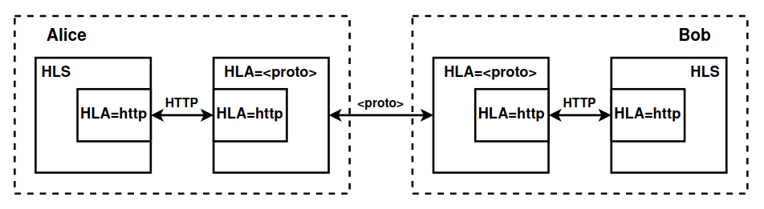

# HLA

> Hidden Lake Adapters


`Hidden Lake Adapters` allow you to adapt anonymizing traffic to various communication protocols and platforms.

## List of adapters

1. [HLA=tcp](hla-tcp) - adapts HL traffic over TCP protocol
2. [HLA=http](hla-http) - adapts HL traffic over HTTP protocol
2. [HLA=https](hla-https) - adapts HL traffic over HTTPS protocol
2. [HLA=meshtastic](hla-meshtastic) - adapts HL traffic over Meshtastic/LoRa protocol

## Installation

It is necessary to replace `<proto>` with an existing adapter in the list.

```bash
$ go install github.com/number571/hidden-lake/cmd/hla/hla-<proto>@latest
```

## How it works

HLA are based on two functions: `Consume` and `Produce`. Due to this, at the interface level, users do not care about the nature of communication: where ciphertexts are read from and where they are written. Due to this property, as well as the properties of QB networks to preserve anonymity in any communication environment, it becomes possible to write adapters not only for network protocols, but also for centralized services, thereby creating secret communication channels.

<p align="center"></p>
<p align="center">Figure 1. Architecture of HLA</p>

## Supported platforms

- Windows (x86_64, arm64)
- Linux (x86_64, arm64)
- MacOS (x86_64, arm64)

## Build and run

Default build and run

```bash 
$ go run ./cmd/hla/hla-<proto>

> [INFO] 2024/12/29 03:40:06 HLA=<proto> is started
> ...
```

Creates [`./hla-<proto>.yml`](./hla-tcp/hla-tcp.yml) file (as example `tcp`).

## Running options

```bash
$ hla-<proto> --path /root --network xxx
# path    = path to config, database, key files
# network = use network configuration from networks.yml
```

## HLA API

> [!NOTE]
> The internal API of all adapters must be the same. Because of this, all adapters inherit adapter HLA=HTTP.

```
1. GET             /api/index          	| params = []
                            			|> description = get name of service
2. GET/POST/DELETE /api/config/connects	| params = []
                            			|> description = get/add/del connections via adapter
3. GET             /api/config/settings	| params = []
                            			|> description = get current settings
4. GET/DELETE      /api/network/online	| params = []
                            			|> description = get/disconnect current online connections
5. GET             /adapter/consume     | params = ["sid":string]
                                        |> description = recv HL message from connections
6. POST            /adapter/produce     | params = []
                                        |> description = send HL message to connections
```

### 1. /api/index

- `200` - return "hidden-lake-adapter=http"

#### 1.1. GET Request

```bash
curl -i -X GET http://localhost:9502/api/index
```

#### 1.1. GET Response

```
HTTP/1.1 200 OK
Content-Type: text/plain
Date: Thu, 15 Jan 2026 10:30:39 GMT
Content-Length: 24

hidden-lake-adapter=http
```

### 2. /api/config/connects

- `200` - return list of connections / add connection / del connection
- `202` - got connection with scheme != http  
- `405` - invalid method (not GET, POST, DELETE)
- `409` - failed read HTTP request body
- `418` - receive void connect string
- `502` - get response from HLA (get, add, del)

#### 2.1. GET Request

```bash
curl -i -X GET http://localhost:9502/api/config/connects
```

#### 2.1. GET Response

```
HTTP/1.1 200 OK
Content-Type: application/json
Date: Mon, 07 Aug 2023 00:21:25 GMT
Content-Length: 49
```

```json
["http://localhost:9581","http://localhost:8888"]
```

#### 2.2. POST Request

```bash
curl -i -X POST http://localhost:9502/api/config/connects --data 'http://localhost:8888'
```

#### 2.2. POST Response

```
HTTP/1.1 200 OK
Content-Type: text/plain
Date: Mon, 07 Aug 2023 00:21:17 GMT
Content-Length: 27

success: update connections
```

#### 2.3. DELETE Request

```bash
curl -i -X DELETE http://localhost:9502/api/config/connects --data 'http://localhost:8888'
```

#### 2.3. DELETE Response

```
HTTP/1.1 200 OK
Content-Type: text/plain
Date: Mon, 07 Aug 2023 00:21:46 GMT
Content-Length: 26

success: delete connection
```

### 3. /api/config/settings

- `200` - return settings from config
- `405` - invalid method (not GET)

#### 3.1. GET Request

```bash
curl -i -X GET http://localhost:9502/api/config/settings
```

#### 3.1. GET Response

```
HTTP/1.1 200 OK
Content-Type: application/json
Date: Sun, 12 Nov 2023 19:01:38 GMT
Content-Length: 120
```

```json
{"message_size_bytes":8192,"queue_period_ms":5000,"work_size_bits":22}
```

### 4. /api/network/online

- `200` - return list of online connections / del online connection  
- `202` - got connection with scheme != http  
- `405` - invalid method (not GET, DELETE)
- `409` - failed read connect string
- `502` - get response from HLA (get, del)

#### 4.1. GET Request

```bash
curl -i -X GET http://localhost:9502/api/network/online
```

#### 4.1. GET Response

```
HTTP/1.1 200 OK
Content-Type: application/json
Date: Mon, 07 Aug 2023 00:23:25 GMT
Content-Length: 25
```

```json
["http://localhost:9581"]
```

#### 4.2. DELETE Request

```bash
curl -i -X DELETE http://localhost:9502/api/network/online --data 'http://localhost:9581'
```

#### 4.2. DELETE Response

```
HTTP/1.1 200 OK
Content-Type: text/plain
Date: Mon, 07 Aug 2023 00:24:14 GMT
Content-Length: 33

success: delete online connection
```

### 5. /adapter/consume

- `200` - return message
- `204` - no received messages
- `405` - invalid method (not GET)
- `406` - subscriber id not registered
- `500` - failed type conversion message

#### 5.1. GET Request

```bash
curl -i -X GET http://localhost:9502/adapter/consume
```

#### 5.1. GET Response

```
HTTP/1.1 200 OK
Content-Type: text/plain
Date: Mon, 07 Aug 2023 00:23:25 GMT
Transfer-Encoding: chunked

e58202a25defe175e0734800c86fc6bf038475405d718713aed11fa4c7d23ee57faeca2b094e5ca735109e6b5ec0012bc047f1bffc9cf03ad52e384716a631f6c338488b3703b1556144ad67dd10409d49047571efc343ce388b635b068c90a87e0577a2866ed6884787cb5d048bc551b0c4f080005d005666b13e36d4208ca909f3e3418983202265d1376bd412433abe1b9448e6f9c3439662c809558f8ff3dfdd0e1caaaa118346d9bce24d7e5278fcb108775fac8ca3e9088d4e59b4aca30a20d7f330be0d62801ab4548b1be24cfe1c0e7acccf9f52fd191c5d752b7d2a57fe9a43e6e26002cb3f99d37790f31c55997018f78b0134265b8b359adac2ecd69f8198d4167a9705d38e0b6f4d59584f052416c7da3b2d5ff396b3042a4a71bc20b61107e4438037cbffcad882d21d95c07e8bdb9f86cc4ec50b8128cf2f2d768087de7de6453fe3a893dc4fea7cb397861ef03a8df71428b3a42001ecd2c8cd567d32b0f830113d7d4fa874a847031436d55a2955c109c0a6a51b6d9c32960e674905b7300367c4259bb417ccdb7df3393e2bde56dd3a67cfb8db67b82027ecdef3e80179f8e3a957ee14b19e68e4ff6db7201e24d0a8341d722eee0880eaba890ef9ac0effd83a06cf28c04097ae8d79b28f80f56f3f5f6eadc2346b41f1c286645a6ab881b812105c42356a8835165b79ad5ba1126438b65e5de371ed662b2df804ca9b48555d672da4b58ead3552b485d59a0208992c1808a7cd27d2dcea4701577c01c39259d74d37cc17f1606f1fd074e8dde8d497f86cdb0ffe2ba08823af494f4e851d5a4c8270e7e2a9d36cc58bc51083615f1975660cbf1bfdeba3fc06074b13d48e4bb298c0dccd4395031720282d1cd7b2d4e7ed22c4f2e8f77d72cb0330f4fa4b0002f1dd361c3a450176d4c65a68c8f3f1a2590ccf04c6282cbeff0b974f61c5564064411f4f94f08b7346f8302b590223013d10ad62fb425fcbe6429cf7378033aab3aadd5ed1d291d170d1bb88c0eb6f24ce595ea0e9df85d1bff8d7af8824ef5407af24b55c5bb79c54d6d0e9ee0dd2a72758ea21eef483511109e56096d81276d168bad2318cdd3ab2800433d1c27a7c872965211edfe0489dc5a770a0917c83b246c42bd8fd5a6dcbf4eb279008b9706858e6b77c74c79b4c15b8c80c14582eabbbc6fabdd79ead4f19d86f9353737535db1e8d256cb5c36f96c609764f6fcc29d33c35ffd856ee802b3fc77dca94ee4298dde0c2a8425bad06987864c43680b0ceb1309612bb4107277596fe469a99c6d22c843563aea1b4a5cd7ab0d0080e065edab48570d76500b6d6f7180444e3e64c21f1bc66657941d7c10dd40225fe1ff40f8d313b1c76945bb19aedaa12265eabf1507fe8bbf44b8dc8b41f6b57fd085ba941cecb74740c343dfbd778cc74708cab360126d3b8631858f408611dfc99c19dbf4c482b3ab65a867f7edade05e37983e07b46bf1e30ea5b03c513bdbd685be7a5a030ea32565a9f54c3e2af0f6b2f463c9d864ac06210b60adc84ae2ac1e5506a26ec0310f7ca0bdcd902ea5e41996b7398a70d9543104327ce8a8c52a7782d31943bbbcd69acc836aed059c8b8f4b433cb9b22a67ad965c86c1efea08ad224e3470c9a309269188607ca51fef2013eafe358144190a746902832bf8fed1f231d84b67c8ad8aefdd3c8d72930f6b4b246ca95252a9139b7132bbcfbe116229a273c1b36b63fca7cfadffc1e84fd78ef6e4852b65def87fafbadf138a3a589b59fc3e1d191edd9cab857fdd3d4cb9ed3dafbd9898837eabd5173a963a81ef8f8508cd0dc65537970f5d530bc499f1aecc6588d9d7bc534b3371a622956cdff7aa21120538c89fb06acbec136cf96373eba28ab53d59c2b954583a40bed024b48d0b876ebb381e90d6c0e9d2d955bf25b960ef9697013f096f9474adc1b695888b1e6a62f5ab9cbbc18f095d57bdec89b64157ee42592b86eb67078d845f57368c1faee4da99ec4ed0905bddefa5351b097ba66b45668e1ea24ba941b22999b10d0cc6a9fadc3570abc0eb65a90b4625f200115da0ee08ff086cfbc7fe0b428849ce6f7d1d9b7f83573ee38b184b153871c44fa50e15af2f13235d8be2d9cc56e74b38b8f4f67c27e1e27473146b35229595b3067cb4cbf3e8b78e7ce7f737d98efb5e25ed3409d0db1dd391e7b1253574732235293cbc8174e3ebcd8b2ea47e50044520a5690160dd12969a0d97492c7dfaf663259f3b563c17c681c38b59a4fbfb6e49d1fe133fa24b74aa70a1fce424a0e7b4043689f3b10d688452143050fa3769d0f46291ac4bb9cde84a0a6040434cdc95c47a54cfb44bea3f4b769ee413be59eed41f869c93c585331d73801a2216c089d4d09f7534990d7600b2dafda72507f4fd3ecbe2708f92342475c3fab3611cc78293a6f3b486426bb0626a13d084cd933073135654281af2844aa37c22d78eef5d85208dfe232654fd857b04ae92fda2f3bbcd598c533b0ac1771369874497fea606bba64156d37832edfff2beed3436785933be01101e4aa1b696cfccf528b2869de9a3b5c97e3403380274bd2897d4dca2176c287c699d561a16193b4a197c39be504cdf4304ffc780ac39846ac0bf8fc749820be01586e7cb5af996491e6a85f14c2c2b7d7e4be5803a51a1ec766bde862e6943bf850764b73ca4ef8a9a192bfeca6d4e745224451f54a36c1c72c21daaba670748cc16636989665ba2725a78e0209e2d6f02b0e0c79e4eb59c9d0f2cb41390a2a29a67e187753dc4abfd83ddb9ff11ce4e1ebfc267622ca0759648421fc6609f4c5c55832009020a7ea511a162cce2508c7d4a0ce75266dba4477bd59a34a3aaa1018b059f0a11d17ffd414677b3bb11e09cf0615574e426be1fc36477383c36aa72ebc3ad38a65ab125f69cb652ffe9ede41842d93c7a65e122be23a81fbc7341e484962508a5d48276d3e51782ba1ab7c1367fa873edb3203ab6b6b6ca1c5bd5b8f342f63e18427fdf86c53b6c48ab9432d7ff11c6056a090f117d8bccc80805b8e56990abd6e9b14ce5389977f1ddbd31c8d9e6429375d902358a6385bdc28c6e716b37d11941aa0d58cdc43330b09863298f0aca1be1055365b77dcf523a207bcf56261eb9b5276ee4eeba40e5a0db6de2c5aea31ebaa8c7fdc1e33676bb83c799fc5115e3447aafe474fbb8b122702dd44a5199e93a3f3bd0a15657c9487890f2d2463c300b36dc51634644b0e8bbc01bf14a224a0bcda87aeaab59afdbb78d2dbc34424502368079a03ce9ec0fdd0fe79dda81716fa67dbf890ffdc47a614aaeef3b06679a0ab690611445a1030047c091ed62d3abe9a9fc1f3538dcfd5e394e902d64084ca6789c4aee60f2d17ea3d50d37d62135c4a640fe9f1b854959ffb1b33fecca83741d019f24a71822de4338d0126a09927e689cf14ca1a73b50cf1044bb2f4c2649f69e6e7b3044cd23c1436c8aab6cffc957b9437f4c39a10ef783e55724c25ff7f8a6e6fc9c2c42ff3d51d02432245e6a4ff4f933a2f6581d69e1de658e48bba9f3fc03b01500cd3f455689c173650904daca47010d5044ac48862eba2c593ebb9ed64476af579434ec70c308e8c66efeaa302c40cbf4ec4e6713aaf5dcee936e568f9ccf1ad42615a1d9d01d55a1f0d78be033faec879c1af969e710242ca2687225cf6d2089d9aba612451d731d344639e4afecb21502c54dc1169dcdac2b71f055a50a87ebf07bc789c3e573771b0b1c7017e6a308f7acffcf3326cd92679a92751337f8a18dcb8267471c208673356b2d3f2ca06bd77f2dc2f52b9f83fa882aa069bb4e5101f2e48dc7eedab4afcc192fd730d0b1e38ed1b582cddc2ab809cb7d9c36e0bedb80b9d2362570214aae6b98906949eb3f7b8a3aef1c8a4189c59f7eeb858d541957dabfed1ef59d366b5ac5fbcfce1874f4b43af032cc1bcd572e47f21fdf2265e97f0fb989b817ed1e8903cfee2629f276cff294b441ed62824afb62fda991f5df0b21a8a6d86c5dd06e9e95cdfb01bdc8a5ea44007a779c985501cbdc3d5bbc27bf299c376998b4331b8d3ff5192fdb5e96e7525f714c133459db7f3082c61891724ca78460298411266fd2ec284d5d2b077b25ff5dc4d67e1c97fd9d4213c85934fd79c01269f1bcc03c361a7744019d0e9c2b23b41f2436d77a4c1f694573e171ae31fc79e5d5eabfb617653795a38b8e9ce5c4ea7658d6267f4472512f329518dc8a62e80c834e9bd13c4de7a9bb78b1b04fd07162a8d25ac1d53a622e5e0801386aee3f20fe6ba371e7a173c2454c5cb67b74eff14b3a81e39b98d05f75be5cf6c47b1d0923edbeac180b6cf9cb3b72ee3294a866419f436b279a9bdb1c888aa5a4ae6cd73e2092d5bcc4b58956b1d6d737fb53fbe3a8a4f3389bbf02b57b9316fdf1d9cfb613b079fcd7f212db5331e8dd6adbe8cc24770fcd50f56866732fbbd98826aac8dc2c388ff711598fe0c5c9b000d771879a8a92ab1fb6030d04e4d543e8808e1a8d6aba3113c59e5da2243ca4b29e8746098a5601cf0db77bd18ce955ca25f1974a0abc240db1b8027b879e9e22284e4f9171b1b4601a809e60427d258df2cf0150b0d197b643112745abbef3b5cb19bfa05381da20f1a349b05142696fef48a8b262af4d1e5bc20442b15f7cb591be0bcfa77d9f11d60a79e15289ee585a1094e47f645096b8c22403c910e70a3863f10cc164b0d45a2b4261153ad83747f7d65afb2e8f220a489575729b73ff06ebc4b60bdfca883797c4ae4526197f19a2dd6182d809da23e12786e2360860b7aa4291e2617385165deec71b97ab0ea251ba92aa8d17985fe2cdfd12125158551ba2950b052a49ce41ff8cefd026d316920a9d5e5e54c0d68fda8ac350db2f105b49c447fff8c3252eaf216ad025c8a478bf48952e38123f8a745e89945463da1b3213c7030a9f260f1186c740b9a5e71c4c8569ade82543f099d750d22a337072b1e2687fab626ec8d1a5c31feeed206911fbe55642d30fec6129b170b0a197016d6f087c11f3b3a00e7a00342d519d64f501e5829c9b056e96118449956ef5411c4900e14e7e5ce9cad453e2ca8ea67752830ffc4b812ab6842498b28f2b6230d313e4feb26c3dbe805c189a8afe27b55ad3e1ec845eaabb59a7e67f79dcfee0660345185cc87d10fe75cea9af00fcf0cddf2aceaf7bee03764cc77609d663723581043284262dfbe6ca8e8e750c6faaf2ef1949e70c603a3d47803d6451c49fc8a8701eda8bbcc10639686b038b7561bb848702fb9ffdcc72261ae194337f9b6afea6c58211de428b1ee3749408ee081d6b7179af195477841c7fe5482e89a856b42e87e9c8425b6022bfe3e832af7410ff5c9279d20685f6b02201054772ce9f83bd4b39abb917483587babd72b3c10be25bcc08d2bdacaca82e754e05726c9a9f5e6a315c791ab8fa1de6f1d311c4a005e2e32e068f4cf0a1a6878dc46f31e41f7f645904daa9d23da0b37e77125d3fd9450d6445901a6bb761d77bcd26416c66ff1db5880c8b12233569bc82fba90dd0f97fa47e43dc885e1fd874770be22fe40baf20ef97586a4629e3ddf453d6db517dd868d3e9ec85004a4330124c35ed12a5b2e41618f28a7e18446cd14873d8ba505817b90c4a42a34912de16387b67f746babc7e2386199045cdf5ae725b4b3db93603a3b854eb1161e5b20dfd11a3a378c9a66d3b70e66e03a28b7b6eaa01e111b2c75e76a09d2615d5b7205afaa72a51e826eba25fceeecc5ba9db539627c745fd12704a097ef5fdda91b82cb44abf2433fa415ed5bb5f141240817a0a50ad2a53b903488f034bbe9ab4ef0a6c0e52cb5378bfef76f0805170c10745d48d5da3c9e4535ddd9d91c0c7e33efe40ffae08595d7e5bf0f9f71865a1737bd3025f50f86f98ae4818112d7df17ffac833c2df4ac0b361807aebbd3221b341bc12752ec63850a20e805e472a943d98cc7289bf1594f132a3382b6b418f31acc22df275b1bf731357cd9e86677cf85cc505712880e502b45a2ed64c32367c4c8193312a1fc16811ea4c438ea57fd36fb06cf5836da579e2b58ef625f7d9a181ea4852bf6e97d221c26748e5bbe46fa85f67a239250e3af424e027e8b635bb416270949ecdc842568fd3dcfa9a44a5294569b66d4da26df5dc263c42a7d053108c83e4390923993864fb68701de441447fcc9ca76eaf7623e9d9a9761eef66badec7db00583708470a208c3aa15d6307e6b66c57240728aac1de4d2530d1564422d098c7ba16b28e7f5b7fadec220346c4dd5c27d8707dfa0e4e16514fbcaddb5add6e43d1be535e2752f95f7ee6f081ebd3fb670f5bab5f8181ce4a419d962602b997a7b2f171a279d83c99eaaa0aa5cb814a5396bf16c705353686c7164c204e62691b013ee87cccba48eefcbb267c61fde5387c44493a8cd9b692c831616f69d7dec1ce05e9ba9fda1fd2fc11bc4fc4ebc382cb95ee3a9fe474126f2ab99786257d1e341383d3c9c47bf24aa95124c1c9e37ddfdc8429f2476b3421219fc660ea642847b4b60912ea7495d74048762277572681e30f30456aca3a64f564b95693258da2512c828d11a21a97ff383c4856fb4b31e4fe3f2c6bfe5aabdd96dbaa02b25d43bf6a374f71df65ce7017dcd6c765a282057ebe3009fb2bb4acb1ee6e2a4fa17360a3193439161d3327ec2c8ce9edc51426fef9f4c89bce72aca875a6cfed19e8de684929f69e063d992613f95ea063ea6c97d37cac04091ce79cb1f862e8a094fafb61c43b21302b4a5e5210b285b07fbce04a6e4d7f0d86e21898492d60d1a586e7c30410c06576e68345654e2bda6eac27036ee40d6a2bb8afb4ad055cc33469b470ee5f562ae916a0fd556592f2f43b72634d293f066b8cd71bf4163b3c2edfbd1ef8f2b2a20a61959532e33590dec168c51141b36360bc565f3819d8bc63d4c966c266de5a5e3efceae93c7204bf5e42a2c188c7479aa1415683cd463a76b5018eb728fcb8673055843861e630754ead33ea67d6d8a66f34e766eadebac27dfc6bfad4ac934f24ae660d339a93d9cbfa850593d2e96e7b661bca2cf589e20435730778ea63cefb28ce47220106480283f9fd0ecac91b64f60df544a808e994f652b041f812ccf88cfcd801361bf863e1c2cbfd37eab172ad4eebf42768e656c9d1921fc1b163459ae58e0c1cd7403449d5394f987650192c82cc9a83bef171d34cc29a732b6d8f9989e45e2074b2ba877c293c49d10a706ea0099acb88d024dfbfb24d7b65aaa78f3e0def9d0e0ccf3ca38ad2e3d29c9db1bfd6e9f054ffd9c658fd8ce0439ce690adbd14b71baaff4c75f279e03cd0d6cbf3e01492da44753fc18d4149a2f1ede4961d3fbdd2838d6bb9a53daa323bbb700d0da3a7adaff3b3a424d8205dfccaaf8ef6d93173d10fa70da22c61bb44c6313172b5b5adfe16e629cfb1b2cc05e1fff39bbb8b8e17a536ca08d6ad264abda19e33353b51dc73723e6c9c58403afbe4c56f90ce07861cec448901a7d50dbf3017daec2b5e44a45f7d64ed43547941d982df9bda8843eb9cd205186b76a1d7e84b57ebfeadab3cfc45e301355cfc7eec53be1aafc33aecd144621f51004218a8f2b16aa975d9cacf63eb8baf6d2fc1d5b8b280455f32efc4824ff731207f0760a912f9eaebba9c4e8867c93f06d9d25c5d381445b427c9350beaf5db5dcadd4699662a17235378c9ba61b15b695b61a054e698258d732f88c8b7d5180e5dcb2d2bc90f53d36bc6670c9e7ceabe300bbcc1eb0995598ca61c7dc30843c149d74bc5f9f902bada7f851c0f70ba5650b974c28138a12eba435cf12da297da7c5fc1b15a0cd2f10d829c25d8174bb24f429c042b3da25d2b67cb05235ada5a7c9ef10aeacf5c45b7b74242214b8a0bc726a96121f8abf53ecbcfa156472e36f62f1448a4ea524b0995eebb39436ca685927e9f79bf58fa54480bd4e16d5ba270c49ac3af620fd744deb868bb41756519bab2c352ee32b69e0fb0b2abae1d9894a16512022791f7cba0deb80fea03e788e1f276072af3a5b851c04f0ae0b8fa2bafe22b72c350f4c7200417cb08f1572a2d7906f1241a7946d5337a7cd3b4757158a1c47130ec0b74bb33a3d3a8f25cdc7d3158fd1e472071e382aa97b3990b13ce435455fb8c26f05fa72e493ee77266a3948c18f34c49e535dd62de7c991922f23544e875d71777679e7fa16ee08432b29f2cf23b1645ba50a76a0e8bc089e8e1a1c4fba67e6f109122a4bbc4c1733398e9c9b45076916bd44038f5ac4e553c90cb45786acaea9e90e5cc96e0ab6bb6cacd61517f19b5a13e08a6c193efbfde4212ac2317eb062c1b929c46346bf9525086c3b3740f17f6b1b65db1d64a187176492de2eb8de9d3a7c25d60e06e1ce66828d69520c5bf75712956f52cf754e03f8521e29ea6b4199dd05561dacf883feeab9e6299c2e87a58e6717a275d8f7b101ac17e27176714d11a38eb076714d41de959616275101e6512fabbda8e123f560e804f500c1d03e7e445af28cf5b9a5d44ab8885468d082bb08d1878faac56f2f823831920e0d75d292546610e377d88beab319a98753f339f54e031d1faa971ce5f83248a021b4e13f86bd2479bff29c64a10365c1168fcec0cbc8d02e26a5b95df42865d4e9c3d74f5d4ab73ab4f5276973a609bb177c743559fb4959575dc877ad97dc077da1461944f719816c7736aeb6fa03f31274f96ca8119f8840812161d4976b4b15f2c68163bf86d093ec9f0f733a2b5b6ed1fc11d631c8d254d7cdcc71b4b970e43d8aef2ee8684768807d0229d4af6152ef2586d9867fbfad9f3b970c7bc339da1221927409f7cf3548868208031e93a3a6c665c1b8438d396bb74c66ac1c42f8322473641e33f336496e086d0befab85d0c64ac5203f8e103eb1abe27c6920805cc596c52a8ed580200e70454c8aa3356b5579b8f5e16b8284dffd8c3ea8f684fb4b286b4e715027b5b09f126b05e5969949df74bcaa14aff9a7190334baeccea0321877ba265fe794cd22ce14fc66e3d8e3287b4171f2bf73c3a207276eb96231452fd924370bd38944eb51e16982996af43abd4710c4a65db49710e49eee2d51765f4d18c333ba464e65356b49fcc7f9721ff554a46bcff0000edea3291879072ce2b723b82deb13e9fa6e994eb3e95a84cf49e997df909d86bc6c81be1d4afb79d67ec63f4461ed0b5732545384e0fb9d99e488fb60e52210fb637eee8d74e840f63710f039721cb2d71502a84a44a06c485e6c3408c4e1ff7a29708213df9c5d37d09a1c78d7eeb879403445906239a12014a59c775cc107647071c90c0622a7186f5b0dfd10f45eb09fee3197f4166c7965d147426214b09a2e77acd173353e9cd8ac1396dcdf4fdd05c5b8f753af610b2a9455cdea4f4413ce9da6b16a38a2c4d9c087a0c335a9b85409ceecb81b41deea74fdf3b2e1876b48852ed9e0991ae191e917c44bab23e97f884cfbe7afb7f3d374af231e92aa8355b0d40d23eda1fd3ec24adcb5a1a07164a2127011ffdcf4eceda48ec7d7463584f5f18b9156160d4581a8a27b8d396d2ee4555b45713cf130c2c6e75fec27e31cbd661fa5ac0dc3a50f11d862a630b1fabb49beb7653cf421c7f8912d268ca1f3cf23cccb891e1afdfdc2ac59d842a0fef66183f7722bf392917ca4cadf24e5ac93e5594b91ec67b2c609c2990b8a33aa9108748d6b66421e8ad77b7276d678e43fb3722b80cee52f3b70b058b751902f7097c7422fa68f606f902ab68dc7a1b909d27c5117440e16809f023cad4ea8fdeea65f4f57999c63fc4015456b54ff894aa2e5bb1666119e1c734f9a767428031011221ed5e422d9980216c3bed4fae0390e1476fe9665810a3858d95183e937f430609ff04f71261b6afcb74d1d0594dd6d470598bc58476d82abfb0284384a33a49075380c7d6cd3763ad49659074776514703ab2f857422da56454f601fe1d4567e1e76123836b187fb2b805f22d7bca539e5d92963e12dcb00b5ece7268c0fdfd9988f3deee20c7e751c566f087c046a2e2d22e283ee8083fff978a35d620da3ebb767b8d4e82d7905e34a015509f25ba8262602b6ce6c0502b02d21a943ab46af9b95f2c8c7aeef2259bc4d4b81354f37a091188573ef34e58670414b58ff63b0a4ff47379d72ba4ff757233b3fc951bccb0ca8b4d2ff98dc5b06d2cd7b409ac80d94bb9503de5e3019224097228a724574fd1de93101832f34309377089effebd5c983316aea8b32f5f23253621fe57266a463a6a85649cc408f561897f8548915be3d5db67ecbe39672e1438e9616fda15a14101d48e71a404db1d8daae2e82d3d7283e7138761aec556df770fd121333999a0b7158aceb09eeddde60ab8a29a0c941783e6134ea30beb3d384abcca5a227792202c5536057ccd607bbc6f02180385f2195a831b05b31b6bec98dc3c02b3b4a4f834a80c84ba2337a425d352b9b4243a41de24f62ad8de90b7ebab82e1545e7821f5514b706217876380cda77989ee7fa5844349bba01bfb43834311f10f4bfe8a033a969e8a5872f29853e3459841f14379c0f1f89593ebdd7c6f5153392650e506c2ca24da23ed96bced4043783f9c5cbf7ef21144e1a8840a234a569e4729bc5c5ed1944b8cd16db016c0a6601b13d29525bd73d15ad154659aa19a8be954dae818aac81ec46e605a2fbbd47cb869c32a7f3d17e0b4fc72f1c89b54898d929ba273916de798153dac1e0122922c3d75fd3531af108be1834bf7978ac8bfbfca6cadedd503ff05999fcff18812fb03b5ede98774331992c44cb94f19d62e2c7a8a53f2e12ea4803cb04314c58520fa5fbe4cf368e2ecc6b64f1ccfcb6854d99132a7be14956472a61069e0295cfdb766957f4c5f6d168be86f37941aed57e8678a30c40c46f8343f8c9c4a6fd57c535ac0fa6a9cccede16fc0906655fa23737e4d9b947d01a7650676528c671239b0b0ddac65eb9b6e032b9eac383013b484203b4fce0c10dc754d6d8285628d6a55d8a5660c351aaa5904c33b24a3f4d94dae46fb96991538cae112f8da871a8013f4085b3553b28747ae6e5887aac9aec080e5416d3352450400a264c887830a5db8e0e260f5847acd46036b13469729d0f4665ed9bb178d907496c73a5b69bd11078dd80910f6af8a0abc8580e6e6e4a509692b63eda40de57f5bdf868784df605c49dc39833aced1a11a337028f2b6515473cb97aac4e5d7a8b0ac139b90dec483ee3efddf071c2237285f7659064e45b8b8c337f5c4dc426d7cc6bfbca050f53132169bace3f90e2ee77cd161d1e52bb3df10329f4d217d003bb43f54577dc174f6773ebbbd641b504ded7fa0bdb62bbaab94bb6ea6a45400fd9e9966651e29f43600857156071d83b486d7d2c2708cc669d13e38dfb3c187b3a771bdbe1bf0826c959a7d24840021e94376c688a9db849cafcedad685c9e526afacf513049666b014fb9e23011ecd67ae85f10f89f052ecfbe2754fa03c937e8f262b2b328ac4cc5bddd072ee5d8d14cd80e0a17293b410bf0004d6d08dfef6f26343eecfb68cb12565c38d356f09c44f7f28debee276cdf6a2dca66b489db9da1571c63b57abbcb159036
```

### 6. /adapter/produce

- `200` - return ok
- `202` - message already has in the cache
- `400` - failed load message (invalid format, another settings)
- `405` - invalid method (not POST)
- `418` - invalid message size
- `500` - channel messages overflow
- `502` - get response from HLA (get, del)

#### 6.1. POST Request

```bash
curl -i -X POST http://localhost:9502/adapter/produce --data 'e58202a25defe175e0734800c86fc6bf038475405d718713aed11fa4c7d23ee57faeca2b094e5ca735109e6b5ec0012bc047f1bffc9cf03ad52e384716a631f6c338488b3703b1556144ad67dd10409d49047571efc343ce388b635b068c90a87e0577a2866ed6884787cb5d048bc551b0c4f080005d005666b13e36d4208ca909f3e3418983202265d1376bd412433abe1b9448e6f9c3439662c809558f8ff3dfdd0e1caaaa118346d9bce24d7e5278fcb108775fac8ca3e9088d4e59b4aca30a20d7f330be0d62801ab4548b1be24cfe1c0e7acccf9f52fd191c5d752b7d2a57fe9a43e6e26002cb3f99d37790f31c55997018f78b0134265b8b359adac2ecd69f8198d4167a9705d38e0b6f4d59584f052416c7da3b2d5ff396b3042a4a71bc20b61107e4438037cbffcad882d21d95c07e8bdb9f86cc4ec50b8128cf2f2d768087de7de6453fe3a893dc4fea7cb397861ef03a8df71428b3a42001ecd2c8cd567d32b0f830113d7d4fa874a847031436d55a2955c109c0a6a51b6d9c32960e674905b7300367c4259bb417ccdb7df3393e2bde56dd3a67cfb8db67b82027ecdef3e80179f8e3a957ee14b19e68e4ff6db7201e24d0a8341d722eee0880eaba890ef9ac0effd83a06cf28c04097ae8d79b28f80f56f3f5f6eadc2346b41f1c286645a6ab881b812105c42356a8835165b79ad5ba1126438b65e5de371ed662b2df804ca9b48555d672da4b58ead3552b485d59a0208992c1808a7cd27d2dcea4701577c01c39259d74d37cc17f1606f1fd074e8dde8d497f86cdb0ffe2ba08823af494f4e851d5a4c8270e7e2a9d36cc58bc51083615f1975660cbf1bfdeba3fc06074b13d48e4bb298c0dccd4395031720282d1cd7b2d4e7ed22c4f2e8f77d72cb0330f4fa4b0002f1dd361c3a450176d4c65a68c8f3f1a2590ccf04c6282cbeff0b974f61c5564064411f4f94f08b7346f8302b590223013d10ad62fb425fcbe6429cf7378033aab3aadd5ed1d291d170d1bb88c0eb6f24ce595ea0e9df85d1bff8d7af8824ef5407af24b55c5bb79c54d6d0e9ee0dd2a72758ea21eef483511109e56096d81276d168bad2318cdd3ab2800433d1c27a7c872965211edfe0489dc5a770a0917c83b246c42bd8fd5a6dcbf4eb279008b9706858e6b77c74c79b4c15b8c80c14582eabbbc6fabdd79ead4f19d86f9353737535db1e8d256cb5c36f96c609764f6fcc29d33c35ffd856ee802b3fc77dca94ee4298dde0c2a8425bad06987864c43680b0ceb1309612bb4107277596fe469a99c6d22c843563aea1b4a5cd7ab0d0080e065edab48570d76500b6d6f7180444e3e64c21f1bc66657941d7c10dd40225fe1ff40f8d313b1c76945bb19aedaa12265eabf1507fe8bbf44b8dc8b41f6b57fd085ba941cecb74740c343dfbd778cc74708cab360126d3b8631858f408611dfc99c19dbf4c482b3ab65a867f7edade05e37983e07b46bf1e30ea5b03c513bdbd685be7a5a030ea32565a9f54c3e2af0f6b2f463c9d864ac06210b60adc84ae2ac1e5506a26ec0310f7ca0bdcd902ea5e41996b7398a70d9543104327ce8a8c52a7782d31943bbbcd69acc836aed059c8b8f4b433cb9b22a67ad965c86c1efea08ad224e3470c9a309269188607ca51fef2013eafe358144190a746902832bf8fed1f231d84b67c8ad8aefdd3c8d72930f6b4b246ca95252a9139b7132bbcfbe116229a273c1b36b63fca7cfadffc1e84fd78ef6e4852b65def87fafbadf138a3a589b59fc3e1d191edd9cab857fdd3d4cb9ed3dafbd9898837eabd5173a963a81ef8f8508cd0dc65537970f5d530bc499f1aecc6588d9d7bc534b3371a622956cdff7aa21120538c89fb06acbec136cf96373eba28ab53d59c2b954583a40bed024b48d0b876ebb381e90d6c0e9d2d955bf25b960ef9697013f096f9474adc1b695888b1e6a62f5ab9cbbc18f095d57bdec89b64157ee42592b86eb67078d845f57368c1faee4da99ec4ed0905bddefa5351b097ba66b45668e1ea24ba941b22999b10d0cc6a9fadc3570abc0eb65a90b4625f200115da0ee08ff086cfbc7fe0b428849ce6f7d1d9b7f83573ee38b184b153871c44fa50e15af2f13235d8be2d9cc56e74b38b8f4f67c27e1e27473146b35229595b3067cb4cbf3e8b78e7ce7f737d98efb5e25ed3409d0db1dd391e7b1253574732235293cbc8174e3ebcd8b2ea47e50044520a5690160dd12969a0d97492c7dfaf663259f3b563c17c681c38b59a4fbfb6e49d1fe133fa24b74aa70a1fce424a0e7b4043689f3b10d688452143050fa3769d0f46291ac4bb9cde84a0a6040434cdc95c47a54cfb44bea3f4b769ee413be59eed41f869c93c585331d73801a2216c089d4d09f7534990d7600b2dafda72507f4fd3ecbe2708f92342475c3fab3611cc78293a6f3b486426bb0626a13d084cd933073135654281af2844aa37c22d78eef5d85208dfe232654fd857b04ae92fda2f3bbcd598c533b0ac1771369874497fea606bba64156d37832edfff2beed3436785933be01101e4aa1b696cfccf528b2869de9a3b5c97e3403380274bd2897d4dca2176c287c699d561a16193b4a197c39be504cdf4304ffc780ac39846ac0bf8fc749820be01586e7cb5af996491e6a85f14c2c2b7d7e4be5803a51a1ec766bde862e6943bf850764b73ca4ef8a9a192bfeca6d4e745224451f54a36c1c72c21daaba670748cc16636989665ba2725a78e0209e2d6f02b0e0c79e4eb59c9d0f2cb41390a2a29a67e187753dc4abfd83ddb9ff11ce4e1ebfc267622ca0759648421fc6609f4c5c55832009020a7ea511a162cce2508c7d4a0ce75266dba4477bd59a34a3aaa1018b059f0a11d17ffd414677b3bb11e09cf0615574e426be1fc36477383c36aa72ebc3ad38a65ab125f69cb652ffe9ede41842d93c7a65e122be23a81fbc7341e484962508a5d48276d3e51782ba1ab7c1367fa873edb3203ab6b6b6ca1c5bd5b8f342f63e18427fdf86c53b6c48ab9432d7ff11c6056a090f117d8bccc80805b8e56990abd6e9b14ce5389977f1ddbd31c8d9e6429375d902358a6385bdc28c6e716b37d11941aa0d58cdc43330b09863298f0aca1be1055365b77dcf523a207bcf56261eb9b5276ee4eeba40e5a0db6de2c5aea31ebaa8c7fdc1e33676bb83c799fc5115e3447aafe474fbb8b122702dd44a5199e93a3f3bd0a15657c9487890f2d2463c300b36dc51634644b0e8bbc01bf14a224a0bcda87aeaab59afdbb78d2dbc34424502368079a03ce9ec0fdd0fe79dda81716fa67dbf890ffdc47a614aaeef3b06679a0ab690611445a1030047c091ed62d3abe9a9fc1f3538dcfd5e394e902d64084ca6789c4aee60f2d17ea3d50d37d62135c4a640fe9f1b854959ffb1b33fecca83741d019f24a71822de4338d0126a09927e689cf14ca1a73b50cf1044bb2f4c2649f69e6e7b3044cd23c1436c8aab6cffc957b9437f4c39a10ef783e55724c25ff7f8a6e6fc9c2c42ff3d51d02432245e6a4ff4f933a2f6581d69e1de658e48bba9f3fc03b01500cd3f455689c173650904daca47010d5044ac48862eba2c593ebb9ed64476af579434ec70c308e8c66efeaa302c40cbf4ec4e6713aaf5dcee936e568f9ccf1ad42615a1d9d01d55a1f0d78be033faec879c1af969e710242ca2687225cf6d2089d9aba612451d731d344639e4afecb21502c54dc1169dcdac2b71f055a50a87ebf07bc789c3e573771b0b1c7017e6a308f7acffcf3326cd92679a92751337f8a18dcb8267471c208673356b2d3f2ca06bd77f2dc2f52b9f83fa882aa069bb4e5101f2e48dc7eedab4afcc192fd730d0b1e38ed1b582cddc2ab809cb7d9c36e0bedb80b9d2362570214aae6b98906949eb3f7b8a3aef1c8a4189c59f7eeb858d541957dabfed1ef59d366b5ac5fbcfce1874f4b43af032cc1bcd572e47f21fdf2265e97f0fb989b817ed1e8903cfee2629f276cff294b441ed62824afb62fda991f5df0b21a8a6d86c5dd06e9e95cdfb01bdc8a5ea44007a779c985501cbdc3d5bbc27bf299c376998b4331b8d3ff5192fdb5e96e7525f714c133459db7f3082c61891724ca78460298411266fd2ec284d5d2b077b25ff5dc4d67e1c97fd9d4213c85934fd79c01269f1bcc03c361a7744019d0e9c2b23b41f2436d77a4c1f694573e171ae31fc79e5d5eabfb617653795a38b8e9ce5c4ea7658d6267f4472512f329518dc8a62e80c834e9bd13c4de7a9bb78b1b04fd07162a8d25ac1d53a622e5e0801386aee3f20fe6ba371e7a173c2454c5cb67b74eff14b3a81e39b98d05f75be5cf6c47b1d0923edbeac180b6cf9cb3b72ee3294a866419f436b279a9bdb1c888aa5a4ae6cd73e2092d5bcc4b58956b1d6d737fb53fbe3a8a4f3389bbf02b57b9316fdf1d9cfb613b079fcd7f212db5331e8dd6adbe8cc24770fcd50f56866732fbbd98826aac8dc2c388ff711598fe0c5c9b000d771879a8a92ab1fb6030d04e4d543e8808e1a8d6aba3113c59e5da2243ca4b29e8746098a5601cf0db77bd18ce955ca25f1974a0abc240db1b8027b879e9e22284e4f9171b1b4601a809e60427d258df2cf0150b0d197b643112745abbef3b5cb19bfa05381da20f1a349b05142696fef48a8b262af4d1e5bc20442b15f7cb591be0bcfa77d9f11d60a79e15289ee585a1094e47f645096b8c22403c910e70a3863f10cc164b0d45a2b4261153ad83747f7d65afb2e8f220a489575729b73ff06ebc4b60bdfca883797c4ae4526197f19a2dd6182d809da23e12786e2360860b7aa4291e2617385165deec71b97ab0ea251ba92aa8d17985fe2cdfd12125158551ba2950b052a49ce41ff8cefd026d316920a9d5e5e54c0d68fda8ac350db2f105b49c447fff8c3252eaf216ad025c8a478bf48952e38123f8a745e89945463da1b3213c7030a9f260f1186c740b9a5e71c4c8569ade82543f099d750d22a337072b1e2687fab626ec8d1a5c31feeed206911fbe55642d30fec6129b170b0a197016d6f087c11f3b3a00e7a00342d519d64f501e5829c9b056e96118449956ef5411c4900e14e7e5ce9cad453e2ca8ea67752830ffc4b812ab6842498b28f2b6230d313e4feb26c3dbe805c189a8afe27b55ad3e1ec845eaabb59a7e67f79dcfee0660345185cc87d10fe75cea9af00fcf0cddf2aceaf7bee03764cc77609d663723581043284262dfbe6ca8e8e750c6faaf2ef1949e70c603a3d47803d6451c49fc8a8701eda8bbcc10639686b038b7561bb848702fb9ffdcc72261ae194337f9b6afea6c58211de428b1ee3749408ee081d6b7179af195477841c7fe5482e89a856b42e87e9c8425b6022bfe3e832af7410ff5c9279d20685f6b02201054772ce9f83bd4b39abb917483587babd72b3c10be25bcc08d2bdacaca82e754e05726c9a9f5e6a315c791ab8fa1de6f1d311c4a005e2e32e068f4cf0a1a6878dc46f31e41f7f645904daa9d23da0b37e77125d3fd9450d6445901a6bb761d77bcd26416c66ff1db5880c8b12233569bc82fba90dd0f97fa47e43dc885e1fd874770be22fe40baf20ef97586a4629e3ddf453d6db517dd868d3e9ec85004a4330124c35ed12a5b2e41618f28a7e18446cd14873d8ba505817b90c4a42a34912de16387b67f746babc7e2386199045cdf5ae725b4b3db93603a3b854eb1161e5b20dfd11a3a378c9a66d3b70e66e03a28b7b6eaa01e111b2c75e76a09d2615d5b7205afaa72a51e826eba25fceeecc5ba9db539627c745fd12704a097ef5fdda91b82cb44abf2433fa415ed5bb5f141240817a0a50ad2a53b903488f034bbe9ab4ef0a6c0e52cb5378bfef76f0805170c10745d48d5da3c9e4535ddd9d91c0c7e33efe40ffae08595d7e5bf0f9f71865a1737bd3025f50f86f98ae4818112d7df17ffac833c2df4ac0b361807aebbd3221b341bc12752ec63850a20e805e472a943d98cc7289bf1594f132a3382b6b418f31acc22df275b1bf731357cd9e86677cf85cc505712880e502b45a2ed64c32367c4c8193312a1fc16811ea4c438ea57fd36fb06cf5836da579e2b58ef625f7d9a181ea4852bf6e97d221c26748e5bbe46fa85f67a239250e3af424e027e8b635bb416270949ecdc842568fd3dcfa9a44a5294569b66d4da26df5dc263c42a7d053108c83e4390923993864fb68701de441447fcc9ca76eaf7623e9d9a9761eef66badec7db00583708470a208c3aa15d6307e6b66c57240728aac1de4d2530d1564422d098c7ba16b28e7f5b7fadec220346c4dd5c27d8707dfa0e4e16514fbcaddb5add6e43d1be535e2752f95f7ee6f081ebd3fb670f5bab5f8181ce4a419d962602b997a7b2f171a279d83c99eaaa0aa5cb814a5396bf16c705353686c7164c204e62691b013ee87cccba48eefcbb267c61fde5387c44493a8cd9b692c831616f69d7dec1ce05e9ba9fda1fd2fc11bc4fc4ebc382cb95ee3a9fe474126f2ab99786257d1e341383d3c9c47bf24aa95124c1c9e37ddfdc8429f2476b3421219fc660ea642847b4b60912ea7495d74048762277572681e30f30456aca3a64f564b95693258da2512c828d11a21a97ff383c4856fb4b31e4fe3f2c6bfe5aabdd96dbaa02b25d43bf6a374f71df65ce7017dcd6c765a282057ebe3009fb2bb4acb1ee6e2a4fa17360a3193439161d3327ec2c8ce9edc51426fef9f4c89bce72aca875a6cfed19e8de684929f69e063d992613f95ea063ea6c97d37cac04091ce79cb1f862e8a094fafb61c43b21302b4a5e5210b285b07fbce04a6e4d7f0d86e21898492d60d1a586e7c30410c06576e68345654e2bda6eac27036ee40d6a2bb8afb4ad055cc33469b470ee5f562ae916a0fd556592f2f43b72634d293f066b8cd71bf4163b3c2edfbd1ef8f2b2a20a61959532e33590dec168c51141b36360bc565f3819d8bc63d4c966c266de5a5e3efceae93c7204bf5e42a2c188c7479aa1415683cd463a76b5018eb728fcb8673055843861e630754ead33ea67d6d8a66f34e766eadebac27dfc6bfad4ac934f24ae660d339a93d9cbfa850593d2e96e7b661bca2cf589e20435730778ea63cefb28ce47220106480283f9fd0ecac91b64f60df544a808e994f652b041f812ccf88cfcd801361bf863e1c2cbfd37eab172ad4eebf42768e656c9d1921fc1b163459ae58e0c1cd7403449d5394f987650192c82cc9a83bef171d34cc29a732b6d8f9989e45e2074b2ba877c293c49d10a706ea0099acb88d024dfbfb24d7b65aaa78f3e0def9d0e0ccf3ca38ad2e3d29c9db1bfd6e9f054ffd9c658fd8ce0439ce690adbd14b71baaff4c75f279e03cd0d6cbf3e01492da44753fc18d4149a2f1ede4961d3fbdd2838d6bb9a53daa323bbb700d0da3a7adaff3b3a424d8205dfccaaf8ef6d93173d10fa70da22c61bb44c6313172b5b5adfe16e629cfb1b2cc05e1fff39bbb8b8e17a536ca08d6ad264abda19e33353b51dc73723e6c9c58403afbe4c56f90ce07861cec448901a7d50dbf3017daec2b5e44a45f7d64ed43547941d982df9bda8843eb9cd205186b76a1d7e84b57ebfeadab3cfc45e301355cfc7eec53be1aafc33aecd144621f51004218a8f2b16aa975d9cacf63eb8baf6d2fc1d5b8b280455f32efc4824ff731207f0760a912f9eaebba9c4e8867c93f06d9d25c5d381445b427c9350beaf5db5dcadd4699662a17235378c9ba61b15b695b61a054e698258d732f88c8b7d5180e5dcb2d2bc90f53d36bc6670c9e7ceabe300bbcc1eb0995598ca61c7dc30843c149d74bc5f9f902bada7f851c0f70ba5650b974c28138a12eba435cf12da297da7c5fc1b15a0cd2f10d829c25d8174bb24f429c042b3da25d2b67cb05235ada5a7c9ef10aeacf5c45b7b74242214b8a0bc726a96121f8abf53ecbcfa156472e36f62f1448a4ea524b0995eebb39436ca685927e9f79bf58fa54480bd4e16d5ba270c49ac3af620fd744deb868bb41756519bab2c352ee32b69e0fb0b2abae1d9894a16512022791f7cba0deb80fea03e788e1f276072af3a5b851c04f0ae0b8fa2bafe22b72c350f4c7200417cb08f1572a2d7906f1241a7946d5337a7cd3b4757158a1c47130ec0b74bb33a3d3a8f25cdc7d3158fd1e472071e382aa97b3990b13ce435455fb8c26f05fa72e493ee77266a3948c18f34c49e535dd62de7c991922f23544e875d71777679e7fa16ee08432b29f2cf23b1645ba50a76a0e8bc089e8e1a1c4fba67e6f109122a4bbc4c1733398e9c9b45076916bd44038f5ac4e553c90cb45786acaea9e90e5cc96e0ab6bb6cacd61517f19b5a13e08a6c193efbfde4212ac2317eb062c1b929c46346bf9525086c3b3740f17f6b1b65db1d64a187176492de2eb8de9d3a7c25d60e06e1ce66828d69520c5bf75712956f52cf754e03f8521e29ea6b4199dd05561dacf883feeab9e6299c2e87a58e6717a275d8f7b101ac17e27176714d11a38eb076714d41de959616275101e6512fabbda8e123f560e804f500c1d03e7e445af28cf5b9a5d44ab8885468d082bb08d1878faac56f2f823831920e0d75d292546610e377d88beab319a98753f339f54e031d1faa971ce5f83248a021b4e13f86bd2479bff29c64a10365c1168fcec0cbc8d02e26a5b95df42865d4e9c3d74f5d4ab73ab4f5276973a609bb177c743559fb4959575dc877ad97dc077da1461944f719816c7736aeb6fa03f31274f96ca8119f8840812161d4976b4b15f2c68163bf86d093ec9f0f733a2b5b6ed1fc11d631c8d254d7cdcc71b4b970e43d8aef2ee8684768807d0229d4af6152ef2586d9867fbfad9f3b970c7bc339da1221927409f7cf3548868208031e93a3a6c665c1b8438d396bb74c66ac1c42f8322473641e33f336496e086d0befab85d0c64ac5203f8e103eb1abe27c6920805cc596c52a8ed580200e70454c8aa3356b5579b8f5e16b8284dffd8c3ea8f684fb4b286b4e715027b5b09f126b05e5969949df74bcaa14aff9a7190334baeccea0321877ba265fe794cd22ce14fc66e3d8e3287b4171f2bf73c3a207276eb96231452fd924370bd38944eb51e16982996af43abd4710c4a65db49710e49eee2d51765f4d18c333ba464e65356b49fcc7f9721ff554a46bcff0000edea3291879072ce2b723b82deb13e9fa6e994eb3e95a84cf49e997df909d86bc6c81be1d4afb79d67ec63f4461ed0b5732545384e0fb9d99e488fb60e52210fb637eee8d74e840f63710f039721cb2d71502a84a44a06c485e6c3408c4e1ff7a29708213df9c5d37d09a1c78d7eeb879403445906239a12014a59c775cc107647071c90c0622a7186f5b0dfd10f45eb09fee3197f4166c7965d147426214b09a2e77acd173353e9cd8ac1396dcdf4fdd05c5b8f753af610b2a9455cdea4f4413ce9da6b16a38a2c4d9c087a0c335a9b85409ceecb81b41deea74fdf3b2e1876b48852ed9e0991ae191e917c44bab23e97f884cfbe7afb7f3d374af231e92aa8355b0d40d23eda1fd3ec24adcb5a1a07164a2127011ffdcf4eceda48ec7d7463584f5f18b9156160d4581a8a27b8d396d2ee4555b45713cf130c2c6e75fec27e31cbd661fa5ac0dc3a50f11d862a630b1fabb49beb7653cf421c7f8912d268ca1f3cf23cccb891e1afdfdc2ac59d842a0fef66183f7722bf392917ca4cadf24e5ac93e5594b91ec67b2c609c2990b8a33aa9108748d6b66421e8ad77b7276d678e43fb3722b80cee52f3b70b058b751902f7097c7422fa68f606f902ab68dc7a1b909d27c5117440e16809f023cad4ea8fdeea65f4f57999c63fc4015456b54ff894aa2e5bb1666119e1c734f9a767428031011221ed5e422d9980216c3bed4fae0390e1476fe9665810a3858d95183e937f430609ff04f71261b6afcb74d1d0594dd6d470598bc58476d82abfb0284384a33a49075380c7d6cd3763ad49659074776514703ab2f857422da56454f601fe1d4567e1e76123836b187fb2b805f22d7bca539e5d92963e12dcb00b5ece7268c0fdfd9988f3deee20c7e751c566f087c046a2e2d22e283ee8083fff978a35d620da3ebb767b8d4e82d7905e34a015509f25ba8262602b6ce6c0502b02d21a943ab46af9b95f2c8c7aeef2259bc4d4b81354f37a091188573ef34e58670414b58ff63b0a4ff47379d72ba4ff757233b3fc951bccb0ca8b4d2ff98dc5b06d2cd7b409ac80d94bb9503de5e3019224097228a724574fd1de93101832f34309377089effebd5c983316aea8b32f5f23253621fe57266a463a6a85649cc408f561897f8548915be3d5db67ecbe39672e1438e9616fda15a14101d48e71a404db1d8daae2e82d3d7283e7138761aec556df770fd121333999a0b7158aceb09eeddde60ab8a29a0c941783e6134ea30beb3d384abcca5a227792202c5536057ccd607bbc6f02180385f2195a831b05b31b6bec98dc3c02b3b4a4f834a80c84ba2337a425d352b9b4243a41de24f62ad8de90b7ebab82e1545e7821f5514b706217876380cda77989ee7fa5844349bba01bfb43834311f10f4bfe8a033a969e8a5872f29853e3459841f14379c0f1f89593ebdd7c6f5153392650e506c2ca24da23ed96bced4043783f9c5cbf7ef21144e1a8840a234a569e4729bc5c5ed1944b8cd16db016c0a6601b13d29525bd73d15ad154659aa19a8be954dae818aac81ec46e605a2fbbd47cb869c32a7f3d17e0b4fc72f1c89b54898d929ba273916de798153dac1e0122922c3d75fd3531af108be1834bf7978ac8bfbfca6cadedd503ff05999fcff18812fb03b5ede98774331992c44cb94f19d62e2c7a8a53f2e12ea4803cb04314c58520fa5fbe4cf368e2ecc6b64f1ccfcb6854d99132a7be14956472a61069e0295cfdb766957f4c5f6d168be86f37941aed57e8678a30c40c46f8343f8c9c4a6fd57c535ac0fa6a9cccede16fc0906655fa23737e4d9b947d01a7650676528c671239b0b0ddac65eb9b6e032b9eac383013b484203b4fce0c10dc754d6d8285628d6a55d8a5660c351aaa5904c33b24a3f4d94dae46fb96991538cae112f8da871a8013f4085b3553b28747ae6e5887aac9aec080e5416d3352450400a264c887830a5db8e0e260f5847acd46036b13469729d0f4665ed9bb178d907496c73a5b69bd11078dd80910f6af8a0abc8580e6e6e4a509692b63eda40de57f5bdf868784df605c49dc39833aced1a11a337028f2b6515473cb97aac4e5d7a8b0ac139b90dec483ee3efddf071c2237285f7659064e45b8b8c337f5c4dc426d7cc6bfbca050f53132169bace3f90e2ee77cd161d1e52bb3df10329f4d217d003bb43f54577dc174f6773ebbbd641b504ded7fa0bdb62bbaab94bb6ea6a45400fd9e9966651e29f43600857156071d83b486d7d2c2708cc669d13e38dfb3c187b3a771bdbe1bf0826c959a7d24840021e94376c688a9db849cafcedad685c9e526afacf513049666b014fb9e23011ecd67ae85f10f89f052ecfbe2754fa03c937e8f262b2b328ac4cc5bddd072ee5d8d14cd80e0a17293b410bf0004d6d08dfef6f26343eecfb68cb12565c38d356f09c44f7f28debee276cdf6a2dca66b489db9da1571c63b57abbcb159036'
```

#### 6.1. POST Response

```
HTTP/1.1 200 OK
Content-Type: text/plain
Date: Mon, 07 Aug 2023 00:21:17 GMT
Content-Length: 0
```
